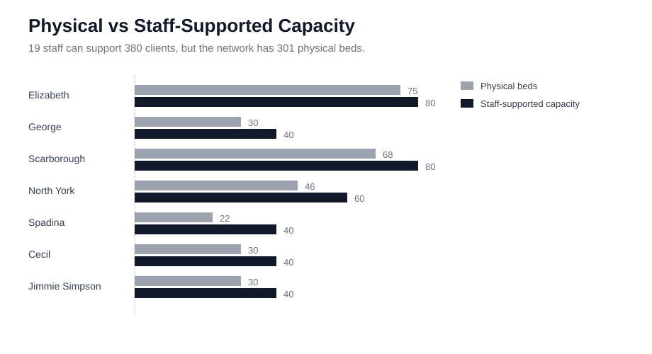

# Toronto Warming Centre Capacity and Staffing

Would an extra staff shift or an extra bed allow Toronto’s warming centres to admit more people on a cold night? This portfolio analysis examines a seven-centre plan from a graduate team project. I rebuilt the demand simulation in Python using the staffing allocation from the original integer optimization.

## The planning decision

The plan assigns **19 staff to 301 beds**. At one staff member per 20 clients, each centre has enough staff for its existing beds. For example, four staff at Elizabeth can support 80 clients, but the site has 75 beds. At that location, five additional beds could be staffed with the existing allocation. [Staffing by centre](results/staffing_results.csv)

| Original planning scenario | Demand | Admitted | Turned away | Reported operating cost |
|---|---:|---:|---:|---:|
| Moderate | 231 | 231 | 0 | $24,717 |
| Extreme | 306 | 297 | 9 | $32,795 |

The extreme scenario leaves nine people unserved. Its reported operating cost is $205 below the stated $33,000 budget. The source table does not itemize payroll and transfers, so the remaining margin cannot be treated as verified funding for expansion. [Scenario results](results/scenario_results.csv) · [Cost assumptions](results/model_assumptions.csv)



## Stress test across 5,000 nights

The notebook holds staffing fixed and draws total arrivals for each 12-hour shift using centre-specific Poisson rates. Extreme nights have a 12% probability and a 10% increase in arrival rates. With seed 42, the simulation produced 574 extreme nights and averaged **17.0 turn-aways per extreme night**. The nine turn-aways above belong to a single planning scenario.

The transfer rule pools spare beds across all sites without a travel or intake limit. On moderate nights, two extreme-weather sites have zero local demand but their beds can still receive transfers in the simulation. This can understate unmet demand if those sites are closed. [Simulation notebook](notebooks/warming_centre_end_to_end.ipynb) · [Python implementation](src/simulation.py)

## Where additional beds could help

The original expansion analysis identified a ten-bed allocation split between **Elizabeth (five) and Scarborough (five)**. Both sites have staffing headroom for those beds. The published expansion summary identifies equal and proportional alternatives but omits their underlying outcomes. It supports reporting the selected locations, while the size of the improvement cannot be independently reconstructed here. [Expansion summary](results/capacity_expansion_results.csv)

## Reproduce the stress test

```bash
pip install -r requirements.txt
jupyter notebook notebooks/warming_centre_end_to_end.ipynb
```

Run the cells in order to generate demand, check centre-level staffing capacity and simulate the fixed plan. The original solver and expansion runs are represented by their saved results.
